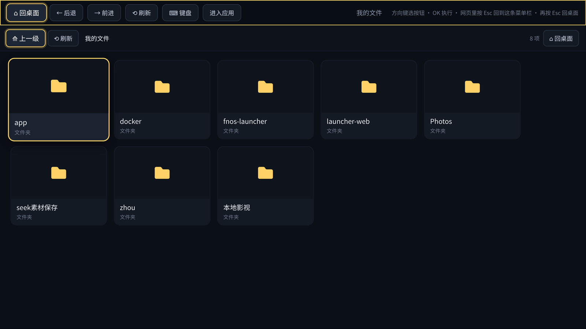
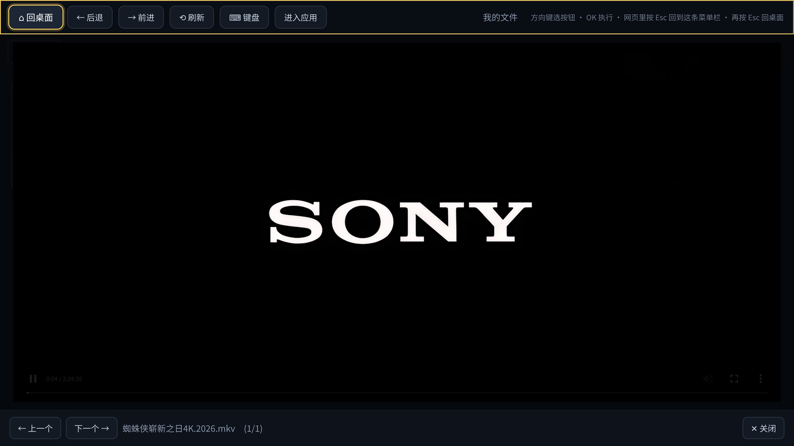

# 飞牛电视启动器（fnOS TV Launcher）

> **⚠️ 写在前面**
> 本人精力有限，这玩意纯属业余**瞎折腾**，能跑就谢天谢地，**不保证没坑**。
> 代码可能写得糙、功能可能残缺、文档可能过时——看懂了就拿去玩，别太当真，更别拿它干正事。
> 有问题欢迎提 Issue，但别指望我秒回 😅

把飞牛 fnOS 的 HDMI 输出变成一台**电视启动器**（其实就是个给自己 NAS 用的大屏首页）：开机直接进大屏，用遥控器或飞鼠就能看飞牛影视、相册、音乐、本地文件，顺手还能上个网。

- 纯 Xorg + Chromium kiosk，不装桌面环境，8G 内存的小主机也跑得动
- 4K / 2K / 1080p 自动适配，换电视、改分辨率都能自己跟上
- 五个入口开机**自动轮播**，不用动它也在动；一按键就停
- 网页是**内嵌**的，顶部菜单栏永远在，不会“进得去出不来”


---

## 目录

- [能做什么](#能做什么)
- [装之前](#装之前)
- [三步安装](#三步安装)
- [遥控器怎么用](#遥控器怎么用)
- [配置](#配置)
- [日常维护](#日常维护)
- [常见问题](#常见问题)
- [目录结构](#目录结构)
- [卸载](#卸载)
- [许可](#许可)

---

## 能做什么

### 五个入口

| # | 入口 | 说明 |
|---|------|------|
| 1 | 飞牛影视 | 内嵌 `http://<NAS>:5666/v`，海报墙与播放 |
| 2 | 飞牛相册 | 内嵌 `/p` |
| 3 | 飞牛音乐 | 内嵌 `/music` |
| 4 | **我的文件** | 自建的本地文件浏览器，直接看 NAS 上的文件夹 |
| 5 | 浏览器 | 带地址栏与常用站点，网页内嵌显示 |

首页空闲时**每 3 秒自动轮播**一个（大标题、说明、配色一起换）；按键或动鼠标就停，停手 20 秒后自动继续。数字键 `1`–`5` 直达。

### 我的文件



- 直接浏览 NAS 上的文件夹（默认根目录 = 你的个人文件夹，如 `/vol1/1000`）
- 图片直接出缩略图，点开全屏看，←/→ 翻上一张下一张
- 视频 `<video>` 直接放，支持拖进度条（服务端支持 Range）
- 文本类（txt / md / yml / json / srt / log …）点开直接预览
- 其它文件给下载链接
- 路径被锁在根目录内，`../` 越界会被拒绝；`.` 开头的隐藏项不显示

> 为什么不直接嵌飞牛的文件管理？它是飞牛主界面的内置应用，**没有独立网址**（`/files`、`/filemanager` 都是 404），而且必须登录。自己写一个反而不依赖登录态、更好用。



### 浏览器：内嵌而不是跳走

必应这类站点带 `X-Frame-Options`，直接 iframe 会白屏，所以自带一个**同源反向代理**：

```text
/p?u=<网址>   →  抓回 HTML → 剥掉禁嵌头 → 改写链接 → 注入按键转发
```

于是网页在 iframe 里是同源的，带来三个好处：

1. 顶部菜单栏和浏览器导航栏**永远在**，随时能回桌面；
2. 网页里按 `Esc` 就能把焦点收回菜单栏，不会“进得去出不来”；
3. 前进/后退能穿透两层。

代理内置 SSRF 防护：内网地址（127.*、192.168.*、10.*）一律拒绝。

### 分辨率自适应

每次启动实时探测电视分辨率，算出 `--force-device-scale-factor` 和 `--window-size`：

```text
3840x2160 → 2.00x → 窗口 1920x1080
2560x1440 → 1.25x → 窗口 2048x1152
1920x1080 → 1.00x → 窗口 1920x1080
1366x768  → 0.75x → 窗口 1821x1024
```

运行中每 10 秒复查一次，电视待机唤醒、HDMI 重新握手后会自动重新适配。

---

## 装之前

- 飞牛 fnOS（Debian 12 系），机器有 **HDMI 或 DP++ 输出**，接电视
- 能 SSH 登录飞牛（设置 → SSH 里打开）
- 建议用**飞鼠**（带鼠标功能的遥控器）：焦点进 iframe 后，纯方向键遥控器收不到键，得靠鼠标点一下顶部工具条

### ⚠️ 浏览器解码限制

Chromium **不支持** HEVC / AC3 / EAC3 / DTS。

- mp4（H.264 + AAC）、部分 mkv（H.264）能直接播
- HEVC 或 AC3 音轨：可能黑屏或**只有画面没声音**

实测 4K `mkv`（H.264 + AC3）**画面正常、无声音**。要完整音效就用「飞牛影视」或在电视上装飞牛 TV。

---

## 三步安装

### 1. 把文件放到飞牛上

任选一种：

- 飞牛网页端「文件管理」里建个目录，把本仓库文件传上去
- 或者直接在飞牛上 `git clone`（如果装了 git）
- 或者在电脑上下好 zip，解压后整体传上去

### 2. SSH 登录飞牛

```bash
ssh 你的用户名@192.168.x.x
cd 到你放文件的目录
```

### 3. 跑安装脚本

```bash
sudo ./install.sh
```

脚本会自动探测 NAS IP、安装目录、电视分辨率，列出来让你确认，然后：

- 装 `xorg / chromium / 中文字体 / alsa` 等依赖（约 1–3 分钟）
- 配置 HDMI 音频和 X 权限
- 建两个 systemd 服务并设为开机自启

装完电视上就有画面了。

**常用参数**

```bash
sudo ./install.sh --yes                        # 不交互
sudo ./install.sh --ip 192.168.1.50            # 手动指定 IP
sudo ./install.sh --port 5666                  # 飞牛 Web 端口（默认 5666）
sudo ./install.sh --web-port 8088              # 启动器自带 Web 端口（默认 8088）
sudo ./install.sh --files-root /vol1/1000/影视 # 「我的文件」只看这个目录
```

---

## 遥控器怎么用

### 首页

- `←` `→` 选应用，`OK` / 回车打开
- `1`–`5` 直达
- 不动它就自动轮播

### 打开应用后

顶部常驻一条工具条：`回桌面 / 后退 / 前进 / 刷新 / 键盘 / 进入应用`

- 工具条高亮时 `←` `→` 选按钮，`OK` 执行
- `↓` 把焦点交给应用
- `Esc` 回桌面
- 焦点进应用后，得**用鼠标点一下工具条**才能继续用方向键选按钮（飞鼠可以，纯方向键遥控器做不到，这是 iframe 方案的硬限制）

浏览器里还能按 `Esc` 把焦点直接收回菜单栏。

### 我的文件

- 方向键在网格里移动，`OK` 打开
- 目录：进入；图片 / 视频 / 音频：全屏播放；文本：预览
- 查看器里 `←` `→` 切上一个 / 下一个，`Esc` 关闭
- `Esc` 一层层退回，退到根目录再按就回到启动器

### 软键盘

工具条上「⌨ 键盘」打开，方向键选字母、`OK` 输入，空格 / 退格 / 清空 / 123 / 前往 / 关闭。
「前往」：输网址直接开，输别的用必应搜索。中文输入做不了（没有输入法）。

---

## 配置

### 改入口

编辑 `<安装目录>/index.html` 顶部的 `APPS`：

```js
const APPS = [
  { name:'飞牛影视', sub:'…', url:BASE + '/v',     color:'#3ddc97', icon:'video' },
  { name:'飞牛相册', sub:'…', url:BASE + '/p',     color:'#4aa8ff', icon:'photo' },
  { name:'飞牛音乐', sub:'…', url:BASE + '/music', color:'#b98bff', icon:'music' },
  { name:'我的文件', sub:'…', url:'./files.html',  color:'#ffd166', icon:'folder' },
  { name:'浏览器',   sub:'…', url:'./nav.html',    color:'#ff9f45', icon:'web' }
];
```

改完 `systemctl restart launcher.service`。

### 改轮播速度

同文件里：

```js
const ROTATE_MS     = 3000;    // 几秒换一个
const IDLE_RESUME   = 20000;   // 停手多久后自动继续
```

### 改「我的文件」根目录

不用改代码，改服务的环境变量：

```bash
sudo systemctl edit launcher-web.service
# 加两行：
# [Service]
# Environment=LAUNCHER_FILES_ROOT=/vol1/1000/影视
sudo systemctl restart launcher-web.service
```

---

## 日常维护

| 想干什么 | 命令 |
|---|---|
| 看当前分辨率/缩放 | `sudo bash <安装目录>/start.sh --dry-run` |
| 改了 index.html 之后 | `systemctl restart launcher.service` |
| 改了 nav.html / files.html / py | 直接生效（每次请求读盘） |
| 看电视画面（不插电视也行） | `sudo bash <安装目录>/remote-view.sh start` → 浏览器开 `http://<NAS>:6080/vnc.html` |
| 截一张当前画面 | `sudo bash <安装目录>/remote-view.sh shot` |
| 临时停掉 | `systemctl stop launcher.service` |
| 取消开机自启 | `systemctl disable launcher.service` |
| 看日志 | `journalctl -u launcher -n 50` |

> 停止只能用 `systemctl stop`，直接 `pkill chromium` 会被 systemd 拉起来。

---

## 常见问题

**电视黑屏提示无信号**

HP 这类小主机的 HDMI 2.0 常靠板载 LSPCON 芯片从 DP 转换，热重启不复位它。
**唯一有效的办法是彻底断电**：关机 → 拔电源线（或关排插）30 秒 → 插回开机。
判断依据：`aplay -l` 里 HDMI 设备名从电视型号变回通用 `HDMI 0`，就是没认到电视。
备选：用主板上的 DP++ 口 + 被动 DP→HDMI 线绕过（限 HDMI 1.4：4K30 或 1080p60）。

**飞牛影视 / 相册里一直显示登录页**

kiosk 的浏览器 profile 从没登录过。用飞鼠在电视上（或远程桌面里）登录一次，之后 Cookie 会保留。

**某个网站内嵌后白屏**

站点有跳转或特殊脚本，报具体网址可以针对性处理。也可以点工具条「进入应用」直接用焦点操作。

**视频没声音 / 放不出来**

浏览器解不了 HEVC / AC3 / DTS（见上文）。换飞牛影视播。

**文字发虚、界面太大或太小**

`sudo bash <安装目录>/start.sh --dry-run` 看探测结果，需要的话 `sudo ./install.sh --scale 2.0` 重设兜底值。

---

## 目录结构

```text
.
├── index.html              # 启动器首页（模板，装的时候写入 IP/端口）
├── start.sh                # Xorg 起来后跑 Chromium，带分辨率自适应与看门狗
├── remote-view.sh          # x11vnc + noVNC，远程看/操作电视画面
├── install.sh              # 一键安装
├── uninstall.sh            # 卸载
├── launcher-web/
│   ├── launcher_web.py     # 同源服务：静态页 + /p 网页代理 + /api/list + /raw
│   ├── nav.html            # 浏览器导航页（地址栏 + 常用站点）
│   └── files.html          # 「我的文件」文件浏览器
└── docs/screenshots/
```

装完后在 NAS 上是这样（`<个人文件夹>` 如 `/vol1/1000`）：

```text
<个人文件夹>/fnos-launcher/
├── index.html  start.sh  remote-view.sh  uninstall.sh
├── .chrome/            # Chromium profile（登录态在这里）
├── .resolution         # 当前生效的分辨率与缩放
└── launcher-web/       # Python 服务目录（含一份 index.html）
```

服务：`launcher-web.service`（8088）→ `launcher.service`（Xorg + Chromium，vt1）。

---

## 卸载

```bash
sudo bash <安装目录>/uninstall.sh
```

停服务、删服务文件、删安装目录、删音频配置。apt 装的 xorg/chromium 会留着（想一起删见脚本末尾提示）。

---

## 许可

MIT，见 [LICENSE](LICENSE)。

本项目按「原样」提供，**不对可用性、安全性、以及它对你 NAS 造成的任何影响负任何责任**。作者精力有限、纯属瞎折腾，玩脱了概不负责——动手前请先备份好数据。
